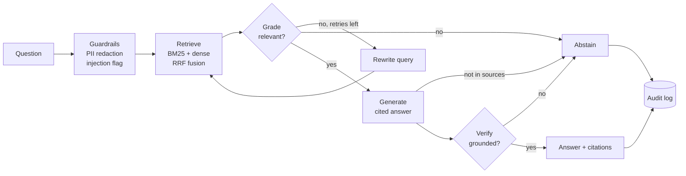

# RegRAG

**An agentic, evaluated RAG assistant for pharma GxP and regulatory knowledge.**
Hybrid retrieval, a LangGraph agent that checks its own work and refuses to guess, a tool-calling
agent that combines documents with a structured CAPA register, an **MCP server** so Claude Desktop or
any MCP client can use it, PII guardrails, an audit log for every answer, and an evaluation suite
that runs as a quality gate in CI. It runs fully
offline out of the box and switches to **AWS Bedrock**, **Azure OpenAI** or **OpenAI** with one
environment variable.


**[Try the live demo →](https://regrag-demo.streamlit.app)** (offline mode, no sign-up)

## Why this exists

In regulated industries a wrong answer with confidence is worse than no answer. An assistant that
answers questions about SOPs, pharmacovigilance timelines or data-integrity rules must:

1. **Cite** the exact document and section behind every sentence.
2. **Abstain** when the approved documents don't answer the question, instead of improvising.
3. **Leave a trail**: who asked what, what was retrieved, what was cited, which model answered.
4. **Prove its quality** with metrics that are re-run on every change, not a demo that worked once.

RegRAG is built around those four requirements. They line up with the record-keeping, transparency
and human-oversight themes of the EU AI Act and with GxP expectations for validated systems.

## How it works



| Component | What it does | File |
| --- | --- | --- |
| Ingestion | Markdown / text / PDF, section-aware chunking with overlap; titles and headings indexed with the body | `ingest.py` |
| Hybrid retrieval | BM25 for exact terms ("ICSR", "Type II") + dense embeddings for paraphrase, fused with Reciprocal Rank Fusion | `index.py` |
| Agent | LangGraph state machine: retrieve → grade → (rewrite) → generate → verify → answer or abstain | `graph.py` |
| Reasoning strategies | `LLMReasoner` (Bedrock Converse, Azure OpenAI, OpenAI) or `HeuristicReasoner` (offline, extractive, IDF-weighted) behind one interface | `reasoners.py` |
| Guardrails | Redacts emails, phone numbers, patient IDs and dates of birth before anything is logged or sent to a model; flags prompt-injection patterns; retrieved text is fenced as data in prompts | `guardrails.py`, `prompts.py` |
| Audit log | One JSONL record per request: hashed user, redacted question, retrieved and cited chunks, model, embedder, grounded/abstained, tokens, latency | `audit.py` |
| Evaluation | Retrieval (hit@k, MRR, recall@k), answer (key-fact recall, citation precision, grounded rate), abstention accuracy, optional LLM-judge relevancy, CI quality gate | `eval/` |
| Tool-calling agent | Planner/executor loop with native tool calling (OpenAI, Azure OpenAI, Bedrock Converse) over SOP search, cited answers and a CAPA register; validated JSON output with one repair attempt; offline deterministic planner for CI | `agent.py`, `tools.py`, `llm.py` |
| MCP server | The same read-only tools plus a `regrag://documents/{doc_id}` resource, over stdio | `mcp_server.py` |
| Serving | Streamlit demo UI, FastAPI (`/ask`, `/health`), Docker image with a non-root user, GitHub Actions CI with a container smoke test | `api.py`, `Dockerfile` |

## Quickstart

```bash
pip install -e ".[dev]"
regrag ingest                      # index data/sample_corpus (offline embeddings)
regrag ask "How many days do we have to submit a serious ICSR?"
regrag eval --gate                 # run the gold set; fails if quality regresses
regrag serve                       # http://127.0.0.1:8000/docs
streamlit run streamlit_app.py     # the demo UI (pip install streamlit)
```

```text
$ regrag ask "Which GAMP category applies to custom bespoke software?"
Systems are classified using GAMP software categories. [1] Category 5 covers custom or bespoke
applications and requires the most rigorous lifecycle controls, including code review. [1]
  [1] IT-007 Computerised System Validation > Software categories (it-007-computerised-system-validation#002)

$ regrag ask "What is the company's parental leave policy?"
I can't answer that from the approved documents. Please check with the document owner or Quality Assurance.
```

### Use a real model

```bash
cp .env.example .env
# AWS Bedrock
export REGRAG_LLM=bedrock REGRAG_LLM_MODEL=anthropic.claude-3-5-haiku-20241022-v1:0
export REGRAG_EMBEDDINGS=bedrock REGRAG_EMBED_MODEL=amazon.titan-embed-text-v2:0 AWS_REGION=eu-west-1
# or Azure OpenAI
export REGRAG_LLM=azure REGRAG_LLM_MODEL=<deployment> REGRAG_EMBEDDINGS=azure REGRAG_EMBED_MODEL=<deployment>
pip install -e ".[bedrock,openai]"
regrag ingest && regrag eval
```

### Free option: Gemini or GitHub Models

The `openai` provider works with any OpenAI-compatible endpoint, so the free tiers of Google Gemini and
GitHub Models run the full pipeline and agent with no code changes:

```bash
export OPENAI_BASE_URL=https://generativelanguage.googleapis.com/v1beta/openai/
export OPENAI_API_KEY=<Gemini API key from Google AI Studio>
export REGRAG_LLM=openai REGRAG_LLM_MODEL=gemini-2.5-flash
export REGRAG_MAX_RPM=8          # stay under the free-tier rate limit
pip install -e ".[openai]" && regrag eval
```

Point `regrag ingest --src` at any folder of PDFs (for example public EMA or ICH guidelines) to use
your own corpus, and add questions to `data/eval/gold.jsonl`.

## Tool-calling agent

Some questions need records, not documents: *"Which critical CAPAs are overdue, and what must happen
within 24 hours of a critical deviation?"* The agent plans which tools to call, runs them, and answers
from their results only.

```text
$ regrag agent "Which critical CAPAs are overdue, and what must happen within 24 hours of a critical deviation?"
2 CAPAs match. CAPA-2026-003 (Enable audit trail on legacy HPLC data system; critical, QA-020) is in
effectiveness check, due 2026-07-19 (OVERDUE). CAPA-2026-007 (Temperature excursion during transport to
Belfast depot; critical, GDP-003) is open, due 2026-08-17 (OVERDUE). Critical deviations must be escalated
to the Qualified Person and the Head of Quality within 24 hours. [1]
  tools: query_capa_register({"classification": "critical", "overdue_as_of": "2026-11-12"}) -> ask_sops(...)
  sources: CAPA-2026-003, CAPA-2026-007, qa-014-deviation-capa#003
```

| Tool | What it does |
| --- | --- |
| `search_sops` | Hybrid search; returns passages with document, section and chunk id |
| `ask_sops` | The full grounded pipeline: cited answer or abstention |
| `query_capa_register` | Filters CAPA records by id, deviation, status, classification, procedure, or overdue date |
| `list_documents` | Lists the approved documents |

Guardrails specific to the agent:

- **No answers from model memory.** If the model answers without calling a tool, the agent refuses.
- **Sources must be real.** Every source in the final JSON must have appeared in a tool result;
  anything else is dropped and recorded in `dropped_sources` and the audit log.
- **Structured output.** The final answer is validated against a Pydantic schema, with one repair
  round if the model returns invalid JSON.
- **Tool errors are data.** Bad arguments come back to the model as an error message so it can retry,
  instead of crashing the loop. All tools are read-only.

## MCP server

Expose the same tools to Claude Desktop, Cursor or any MCP client:

```bash
regrag ingest                     # build the index once
regrag mcp                        # stdio MCP server
```

Claude Desktop (`claude_desktop_config.json`):

```json
{
  "mcpServers": {
    "regrag": {
      "command": "regrag",
      "args": ["mcp"],
      "env": {
        "REGRAG_INDEX_DIR": "/absolute/path/to/regrag/.index",
        "REGRAG_CAPA_REGISTER": "/absolute/path/to/regrag/data/registers/capa_register.csv"
      }
    }
  }
}
```

Tools are annotated read-only and non-destructive. Each document is also available as a resource at
`regrag://documents/{doc_id}`.

## Evaluation

Gold set: 25 answerable questions across 8 SOPs and policies, plus 3 out-of-scope questions the system
must refuse. Each question lists its source document(s) and the key facts a correct answer must state.

**Offline baseline** (`heuristic-extractive` + `hashing-2048` embeddings; runs in CI on every push):

| Metric | Value | What it means |
| --- | --- | --- |
| hit@3 / MRR | 1.00 / 1.00 | Correct SOP retrieved first for every question |
| Key-fact recall | 0.88 | Answer states the required fact (e.g. "15 calendar days") |
| Citation precision | 1.00 | Every cited source is the correct document |
| Grounded rate | 1.00 | Every answer passed the verifier |
| Abstention accuracy | 1.00 | All out-of-scope questions refused |
| Answer rate | 0.96 | Answerable questions not refused |

CI fails the build if hit@3 < 0.9, key-fact recall < 0.7 or abstention accuracy < 0.66. The gate earned
its place during development: the first version of the offline grader answered 2 of 3 out-of-scope
questions because generic words like "company" and "policy" counted as matches. IDF weighting and
light stemming fixed it; the unit tests now pin that behaviour.

The remaining misses (listed in `reports/eval_report.md`) are vocabulary gaps that need a language
model: "sales rep" vs "sales representative", "pass mark" vs "score required to pass". On an 8-document
corpus retrieval is near-trivial, so treat these as a regression baseline, not a benchmark.

<!-- TODO: add a row for Bedrock (Claude Haiku + Titan v2) after running `regrag eval` with credentials -->

## Design decisions

- **Abstain over improvise.** Three independent exits lead to a refusal: nothing relevant retrieved
  (after one query rewrite), the model says the sources don't contain the answer, or the verifier finds
  an unsupported claim. In a GxP setting a refusal is a safe failure; a fabricated deadline is not.
- **Hybrid retrieval.** Regulatory text is full of exact identifiers (EudraVigilance, Type II, GAMP
  Category 5) that dense embeddings blur; BM25 catches them, dense retrieval catches paraphrase. RRF
  needs no score calibration between the two.
- **Strategy interface for reasoning.** The agent graph doesn't know whether a step is answered by
  Claude on Bedrock or by a deterministic heuristic. That keeps CI free, fast and reproducible, and
  makes model swaps a configuration change.
- **Audit by default.** Questions are redacted before logging, users are hashed, and each record links
  the answer to the exact chunks and model version used, which is what an auditor or incident
  investigation needs.

## Roadmap

- Cross-encoder re-ranking (Bedrock Rerank / Cohere) and a re-ranking ablation in the eval report
- pgvector backend for multi-tenant deployment
- LangSmith / OpenTelemetry tracing and a RAGAs comparison run
- Agent evaluation set (tool-selection accuracy, answer correctness on register + SOP questions)
- Terraform module for ECS Fargate + Bedrock with private VPC endpoints

## Project layout

```
src/regrag/         library, agent, API and CLI
data/sample_corpus/ 8 synthetic SOPs for a fictional company (no real or confidential content)
data/registers/     synthetic CAPA register (CSV) used by the agent and MCP server
data/eval/          gold question set
tests/              unit, pipeline, agent, MCP, API and evaluation-gate tests (25)
reports/            latest evaluation report
```

The sample corpus describes a fictional company and was written for this project. Regulatory figures
in it (for example ICSR timelines) follow public EU guidance but are simplified; don't rely on them for
compliance decisions.

## License

MIT
